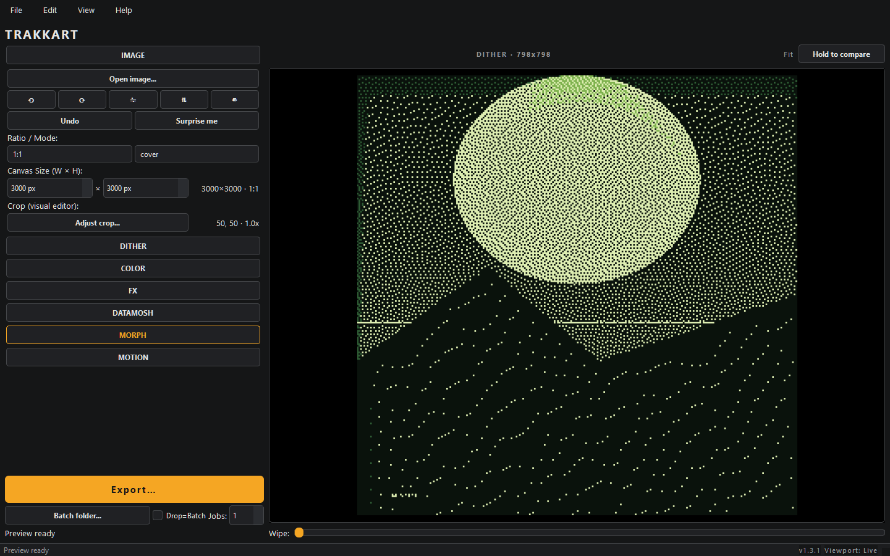
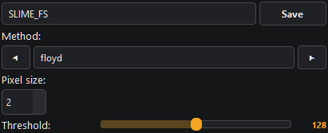
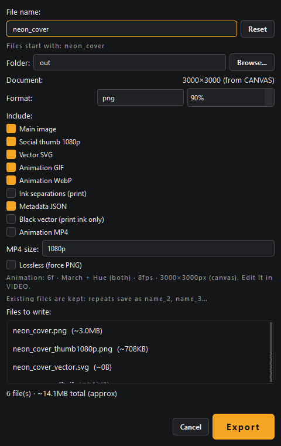
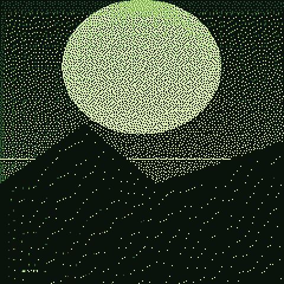

# TRAKKART

Part of the ShardBeats **TRAKK SUITE**. Offline cover-art studio: turn any image
into dithered artwork for singles, posters, merch and socials. 100% local —
nothing is uploaded, nothing is tracked.



## What it does

- **36 dither engines** — ordered (Bayer, blue-noise, halftone, …), error
  diffusion, Hilbert, CMYK, ASCII, edges, motif builder.
- **Canvas-first** — ratio presets or free Custom W×H with
  cover / contain / stretch / blur framing.
- **Color** — TRAKK palettes (BW / SLIME / VAPOR / EMBER), palette library,
  auto-extract from source, duotone / posterize / split-tone.
- **FX + datamosh + particles** — reorderable effect stack, 7 mosh flavors,
  particle morph chain with seamless loop.
- **Motion preview** — still-image preview with fit / zoom / pan + hold-to-compare,
  VIDEO preview (Draft 720p / HD 1080p / Full doc).
- **Export bundle** — main image at canvas size + optional 1080p thumb,
  vector SVG, animated GIF / WebP, MP4, `metadata.json`, ink separations,
  SP-404MKII BMP (128×64 1-bit still for the Roland OLED).





Captured from the real app (SLIME_FS preset on a generated synthwave cover).
Regenerate with `python tools/capture_readme_shots.py` (isolated data dir,
neutral `out/` folder, no personal paths).

## Requirements

- 64-bit Windows 10/11. No internet, no Python install.
- The `.exe` ships everything: acceleration (numba) + MP4 (FFmpeg).

## Download

Grab the latest release from
[Releases](https://github.com/shardbeats/TRAKKART/releases):

- **Installer** — `TRAKKART-Setup-<version>.exe` (Start menu shortcut).
- **Portable** — `TRAKKART-portable-<version>.zip` (unzip anywhere, run
  `TRAKKART.exe`).

Verify integrity with the published SHA-256 checksums before running.

## Installation

1. **Installer:** run `TRAKKART-Setup-<version>.exe` and follow the wizard.
2. **Portable:** unzip `TRAKKART-portable-<version>.zip` and run
   `TRAKKART.exe`. Your presets/palettes travel with the `data/` folder.
3. **First launch:** Windows SmartScreen may warn on an unsigned build —
   *More info → Run anyway*. See `installer/SIGNING.md` for the signing plan.

## Quick start

1. **Open an image** — File → Open (Ctrl+O), drag it onto the window,
   or paste (Ctrl+V).
2. **Pick a method** — the ◀ ▶ buttons cycle through the 36 engines.
3. **Adjust color** — SOURCE extracts the palette, Depth limits tones,
   🎲 reshuffles (🔒 locks keep the good inks).
4. **Animate (optional)** — the VIDEO panel previews; GIF exports at
   document size, MP4 defaults to 1080p.
5. **Export** — Export… (Ctrl+Shift+S) or Quick export (Ctrl+S).

Full guide: [`MANUAL.md`](MANUAL.md) (also bundled — Help → User manual, F1).

## Privacy

Zero network (unless you drop an image URL yourself), zero telemetry,
zero accounts. Everything lives in the app's data folder
(Help → Show logs folder). Deleting it factory-resets the app.

## License

- **TRAKKART source code:** MIT — see [`LICENSE`](LICENSE).
- **Bundled FFmpeg binary:** GPLv3 — ships with `licenses/GPL-3.0.txt`,
  `licenses/LGPL-3.0.txt` (Qt) and a generated `FFMPEG-BUILD-INFO.txt`.
  Source offer in every release notes. Details in
  [`THIRD-PARTY-NOTICES.md`](THIRD-PARTY-NOTICES.md).
- **Brand:** `ShardBeats™`, `TRAKK™`, `TRAKKART™`, the icon and bundled
  preset/palette names are trademarks, not covered by MIT —
  see [`NOTICE.md`](NOTICE.md).

## For developers

```bat
start.bat
run.bat
.venv\Scripts\python -m pytest tests -q -n auto -m "not slow"
```

Architecture, layout and quality gates: [`docs/DEVELOPMENT.md`](docs/DEVELOPMENT.md).
